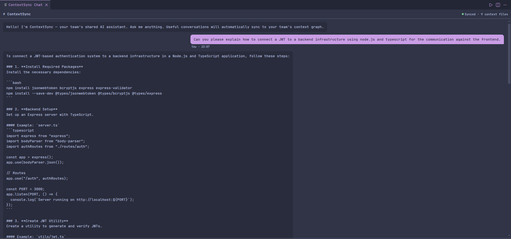
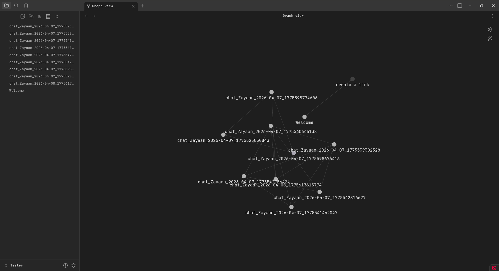

# ContextSync

> **Stop re-explaining your code to AI.** Collaborative context sharing for VS Code teams.

ContextSync lets teams share AI conversation context automatically.
Useful public conversations are saved as immutable structured `.md` segments,
synced via OneDrive to your team's Obsidian vault, and retrieved when relevant
to another team member's question.

**Works with GitHub Copilot, Claude (Anthropic API), ChatGPT (OpenAI API), and any VS Code language model provider.**

Why?
1. **Team Memory:** Enables collaboration across dev teams
2. **Zero Effort:** Context is saved and shared automatically
3. **Locally Controlled:** Sync in real time and hide conversations with privacy mode
4. **Direct Integration:** Use `@contextsync` directly in Copilot chat

[Install from the VS Code Marketplace](https://marketplace.visualstudio.com/items?itemName=ZayaanBhanwadia.context-sync)

| Local Context Generation | Real-time Team Sync |
| :---: | :---: |
|  |  |
---

## How It Works

```
You chat in VS Code
      ↓
ContextSync saves chat as .md (chat_zayaan_2025-01-15_001.md)
      ↓
OneDrive syncs .md to the team vault
      ↓
Bob opens VS Code → ContextSync loads Zayaan's .md
      ↓
Bob's AI chat has Zayaan's context automatically
```

---

## Setup

### 1. Install dependencies
```bash
npm install
npm run compile
```

### 2. Configure settings (VS Code Settings → search "ContextSync")

| Setting | Description | Example |
|---|---|---|
| `contextSync.syncFolder` | Path to your OneDrive/Obsidian folder | `/Users/zayaan/OneDrive/team-context` |
| `contextSync.username` | Your display name for file naming | `zayaan` |
| `contextSync.maxContextFiles` | Max relevant context files injected per request | `5` |
| `contextSync.retrievalMode` | `lexical` (default) or `hybrid` with weighted graph traversal | `"hybrid"` |
| `contextSync.maxContextBytes` | Shared context block limit in UTF-8 bytes; model token checks remain separate | `4096` |
| `contextSync.maxGraphDistance` | Maximum weighted query-to-note distance in hybrid mode; `0` disables expansion | `4` |
| `contextSync.maxGraphNodes` | Maximum settled nodes per hybrid search; edge scans also have a hard bound | `200` |
| `contextSync.maxInputTokens` | Conservative input budget for direct API models; lower for smaller models | `12000` |
| `contextSync.anthropicModels` | Anthropic models shown once a key is stored | `["claude-sonnet-4-5"]` |
| `contextSync.openaiModels` | OpenAI models shown once a key is stored | `["gpt-4o"]` |

### 3. Choose your AI provider

ContextSync talks to models three ways — use any or all:

| Provider | How |
|---|---|
| **GitHub Copilot** | Just sign in — all Copilot models (including its Claude/GPT models) appear in the model picker |
| **Claude (Anthropic API)** | Run **ContextSync: Set Anthropic API Key** from the command palette and paste your key |
| **ChatGPT (OpenAI API)** | Run **ContextSync: Set OpenAI API Key** and paste your key |
| **Other LM providers** | Any extension that registers models with VS Code's Language Model API shows up automatically |

API keys are stored in your OS keychain via VS Code SecretStorage — never in
settings files. Run the same command and submit an empty input to clear a key.
Edit `contextSync.anthropicModels` / `contextSync.openaiModels` to change which
model IDs appear in the picker.

### 4. Open the chat
Run **ContextSync: Open Chat** from the command palette (`Ctrl+Shift+P`),
or type `@contextsync` in GitHub Copilot chat (the `@contextsync` participant
requires Copilot since it runs inside Copilot Chat).

---

Privacy changes start a fresh session and cancel in-flight replies, preventing
private history from influencing later public exports. Private content is not
persisted. Public pending exports are stored per workspace with their original
vault destination. Run **ContextSync: Recover Pending Exports** to retry after a
failure or restart. Legacy recovery asks you to choose the original vault because
older versions did not record its location.

ContextSync runs in the local UI extension host, including with remote workspaces,
so `syncFolder` refers to the local machine's OneDrive/Obsidian folder. Browser-only
VS Code without a local Node extension host is not supported.

VS Code model requests use the selected model's token counter. Direct API requests
use a conservative UTF-8 byte budget, not an exact provider tokenizer. Older turns
are dropped as complete exchanges; an oversized current message produces an error.
Background exports only use VS Code models with existing consent. The **↻ Models**
button explicitly refreshes model discovery after a panel is restored.

---

## Context retrieval

Lexical mode ranks cached notes by distinct keyword overlap in tags, topics,
summaries, and decisions, breaking ties by modification time and then filename.
It injects matching facts with source names and returns no shared context when
nothing matches. It remains the default.

Enable hybrid retrieval in Settings:

```json
{
  "contextSync.retrievalMode": "hybrid"
}
```

Hybrid mode combines lexical ranking with multi-source Dijkstra shortest-path
search over explicit `[[wikilinks]]`. Links work in both directions, including
backlinks. Only notes already loaded from the flat sync folder are eligible;
links never open files or URLs. Headings and aliases such as
`[[chat_alice.md#Decision|Read more]]` resolve to the cached note.

Each link costs `2 - Jaccard(tagsA, tagsB)`, so strongly overlapping tags cost
less, with costs between 1 and 2. Up to three lexical seeds receive query-edge
costs of `1 - score / bestScore`. Dijkstra finds minimum cumulative costs from
that virtual query source. Selection tries the strongest lexical match first, and at most
two linked supporting notes may use up to half the file slots. Remaining slots
use lexical results. Graph results include their route (`via`) and distance.

Default traversal limits are weighted distance 4, 200 settled nodes, and 4,000
scanned edges. A manually edited note contributes at most its first 64 link
entries. The graph index is built lazily and invalidated on cache changes;
search bounds do not limit the one-time cost of indexing the loaded vault.
Only settled shortest paths are returned when a traversal limit is reached.

Both modes respect the file cap and UTF-8 byte cap, keeping complete JSON records
and passages. Fields or notes that cannot fit may be omitted. The model adapter
then checks its input budget separately. The byte limit is not an exact token
count, and shortest paths do not guarantee token savings or better answers.

Hybrid mode can recover linked facts that do not repeat the query's words, but
irrelevant or obsolete links can displace useful lexical matches. Keep lexical
mode unless the vault's links are useful for the questions being asked. Treat
all retrieved content as untrusted reference material in either mode.

## Retrieval tests and benchmarks

```bash
npm test
npm run benchmark:retrieval -- --output=out/retrieval-benchmark.json
```

The benchmark compares lexical and hybrid modes using the real filesystem
loader, parser, and retrieval code, with VS Code configuration stubbed. It
reports cold first-query and warm median/p95 timings, payload bytes, and raw
samples. Loading, network requests, and model inference are outside query timing.
Use `--quick` for a smaller smoke run.

Eight manually labeled synthetic cases check supporting-fact recall, including
backlinks, multiple hops, broken links, no matches, and a noisy-link
counterexample. These are diagnostic fixtures, not a representative answer-quality
study or evidence for a token-reduction percentage. Benchmark reports remain
local build artifacts. See [benchmark methodology](docs/retrieval-benchmarks.md).

---

## File Format

A session produces content-addressed Markdown segments (`chat_<session>_<hash>.md`).
Later exports preserve earlier segments, and retries reuse existing segments.
Existing files from older versions remain readable. Example segment:

```md
---
id: zayaan-01-15_1736934720000
author: zayaan
topic: "How should we structure the auth middleware"
tags: [auth, backend, typescript]
created: 2025-01-15T10:32:00Z
updated: 2025-01-15T10:45:00Z
---

## Summary
Decided to use JWT with 15-minute expiry and refresh token rotation...

## Key Decisions
- JWT with 15min expiry + refresh token rotation
- Auth middleware lives in /packages/auth

## Context Links
- [[chat_bob_2025-01-14_003]]
```

---

## Project Structure

```
src/
├── extension.ts          # Entry point, registers commands
├── types.ts              # Shared TypeScript types
├── chat/
│   ├── ChatPanel.ts      # WebviewPanel lifecycle
│   └── ChatHandler.ts    # Prompt assembly + context injection
├── context/
│   ├── ContextManager.ts # Loads .md files, builds context blocks
│   ├── ContextGraph.ts   # Weighted wikilinks and bounded multi-source Dijkstra
│   ├── MinHeap.ts        # Binary priority queue for shortest-path search
│   ├── markdownParsing.ts# Pure parsing helpers (unit tested)
│   └── FileWatcher.ts    # Watches sync folder for changes
├── llm/
│   ├── ModelRouter.ts    # Routes to Copilot / Anthropic / OpenAI
│   └── directClients.ts  # Direct Anthropic + OpenAI API clients
├── markdown/
│   └── MarkdownExporter.ts  # Exports sessions to structured .md
├── test/
│   ├── contextGraph.test.ts     # Heap, shortest paths, graph bounds
│   ├── hybridRetrieval.test.ts  # Retrieval integration and byte budgets
│   └── markdownParsing.test.ts # Parsing tests (npm test)
└── webview/
    └── chat.html         # Chat UI (vanilla JS)
```

---

## Contributing

Find the project at https://github.com/ZayaanB/Context-Sync

**Note:** Updating the GitHub repository does **not** automatically update the extension for users. To release, bump the version in `package.json` and run `vsce publish` (requires a VS Code publisher account).
